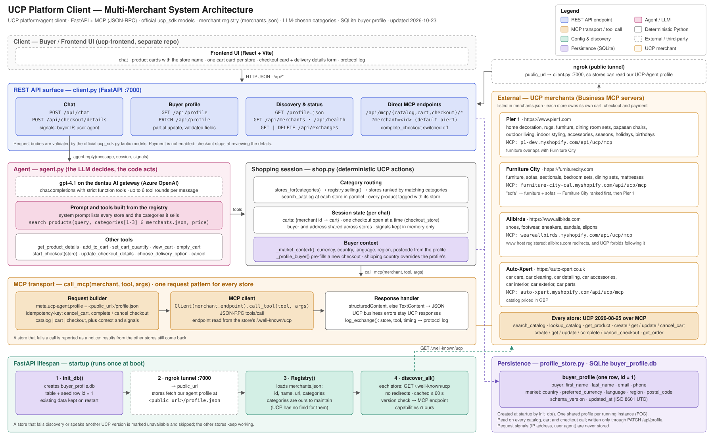
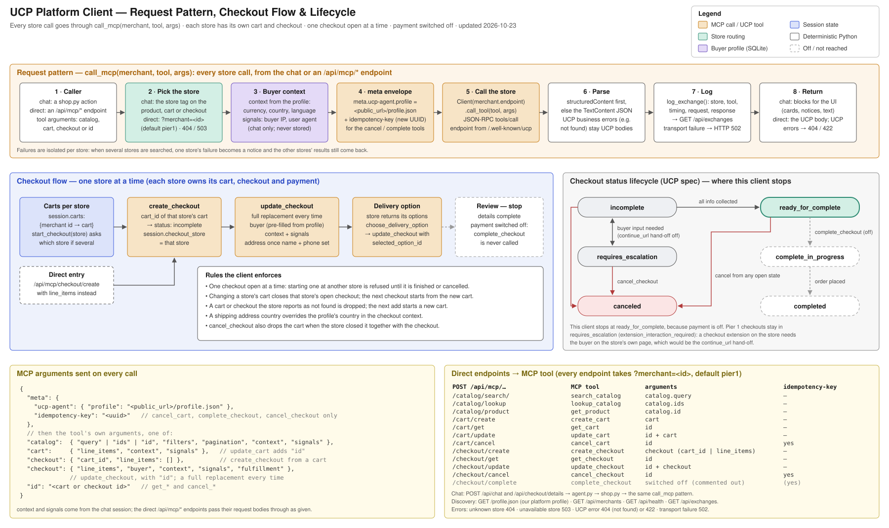

<h1>UCP Client</h1>

The objective of this project is to build a functional UCP client operating over the MCP transport. 
The project has been developed using the UCP SDK classes and is built to be fully compliant with any UCP-conformant merchant that is publicly accessible.

<h2>Architecture</h2>

<h2>Project Structure</h2>
<code>client.py</code> - Main driver of the application. It serves as the entry point for the FastAPI app and handles the
following important tasks:
<ul>
    <li>Initializes app state</li>
    <li>Sets up dependencies</li>
    <li>Uses ngrok to expose a public endpoint to allow merchants to inspect the client profile</li>
    <li>Defines API endpoints used by the client's frontend</li>
    <li>Defines the <code>call_mcp</code> method used by the <code>store</code> to call any tools for a merchant</li>
</ul>

<code>agent.py</code> - Enables the shopping chat. Uses OpenAI's <code>gpt-4.1</code> model to enable responses to 
user actions - plain text as well as calling functions - which uses <code>shop.py</code> to actually execute the MCP tools.
The model support proves especially valuable after the addition of multi-merchant support. The model, given specific instructions 
is able to decide which merchant to call given user's intent.

<code>shop.py</code> - The actual shopping session under the hood. The <code>agent</code> decides what to call and the methods 
in here actually do the work by using the mcp tool calls. After adding multi-merchant support, it keeps the cart and checkout 
isolated to each merchant, since each merchant/business owns their checkout. Therefore, it naturally follows that only
one checkout operation with a given merchant can be active at a given time.

<code>merchants.py</code> - Added to support multiple merchants. It uses <code>merchants.json</code> to infer the 
merchants available & the categories each merchant deals with. For each entry in the file, the code here initializes a new
merchant object and adds them all to the registry of merchants with details like id, name, categories, mcp_endpoint, etc.
<code>client.py</code> initializes the registry & passes it over to agent as context which in turn decides which merchant to query
& shop does the actual operation.

<code>profile_store.py</code> - Adds state for the buyer profile to record signals such as the market the user is shopping
in to personalize the data presented to the user. It uses SQLite to power the mechanism offering a simple interface to update 
the sole user profile.

<h3> Application Lifecycle </h3>

The diagram below shows how a request travels to a merchant and back, and how a checkout moves through its states.
The top row is the pattern every store call follows through <code>call_mcp</code>: pick the store, add the buyer context
from the profile, wrap the arguments in the <code>meta</code> envelope (with an idempotency key where UCP requires one),
call that store's MCP endpoint, then parse, log and return the response.
The middle row shows the checkout flow, run one store at a time, next to the UCP checkout status lifecycle and where this
client stops; the bottom row shows the arguments sent on every call and maps each <code>/api/mcp/*</code> endpoint to its MCP tool.
Payment (<code>complete_checkout</code>) is shown for completeness but is switched off in this client.

<h3>Cart and checkout</h3>
After adding support for multiple merchants, each merchant maintains its own state.
Therefore, instead of maintaining a single, global cart across merchants, there are as many carts as there are merchants.
And it follows that, checkout will have to be executed per merchant, one at a time.

<h3>Personalization</h3>
In order to provide a better user experience, user signals like the country of residence and desired currency codes are
recorded, persisted and eventually passed on to the merchant as context & buyer signals.
When a merchant supports a particular geography or currency, the data will flow in the desired currency. Otherwise, the
default merchant output is relayed back to the user.